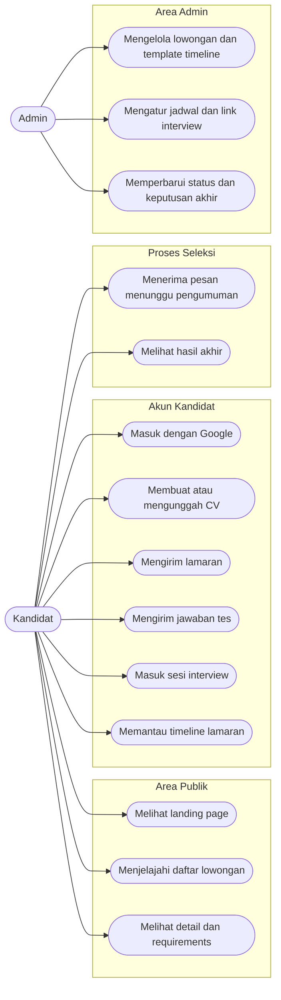
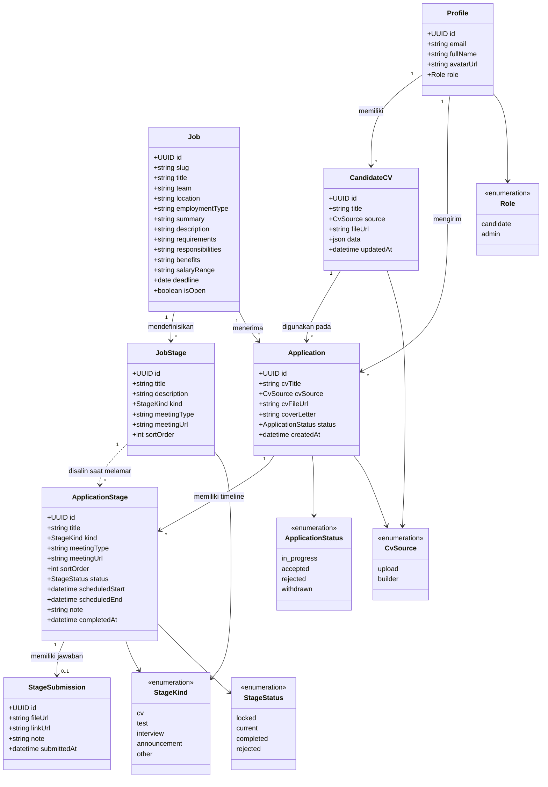
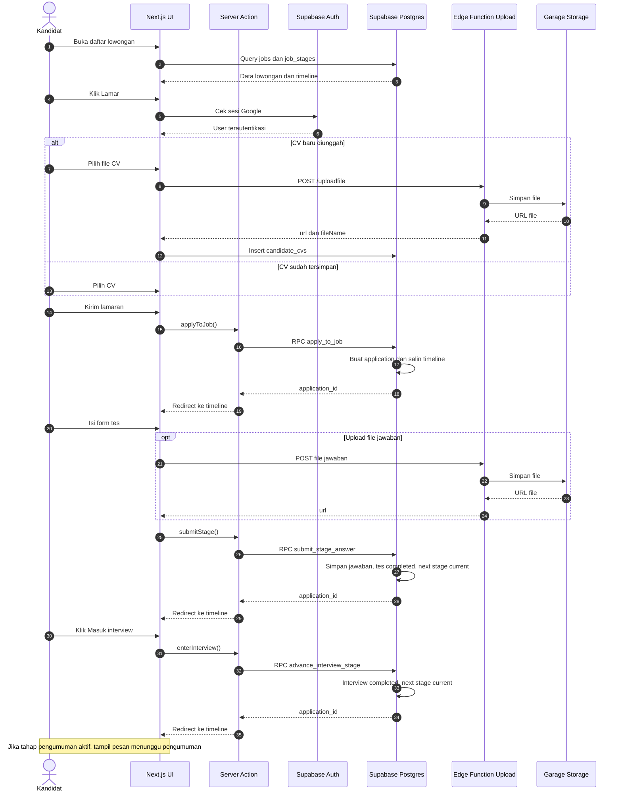
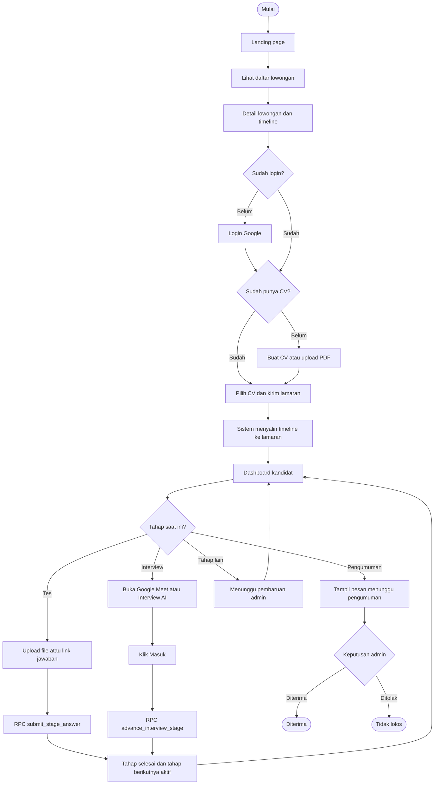

# SekolahKarir — Portal Karier

Landing page rekrutmen dan portal kandidat untuk **SekolahKarir**, sebuah platform yang membantu siswa, sekolah, dan dunia kerja saling terhubung. Project ini mencakup proses dari mengenal lowongan, menyiapkan CV, mengirim lamaran, sampai memantau setiap tahap seleksi.

Tampilan menggunakan palet biru solid tanpa gradient, dengan layout responsif untuk desktop dan mobile.

## Tentang Project

SekolahKarir ingin membuat proses rekrutmen terasa lebih transparan. Kandidat tidak hanya melihat daftar lowongan, tetapi juga memahami persyaratan, mengirim CV, dan mengetahui posisinya dalam proses seleksi.

Setiap lowongan memiliki timeline yang dapat berbeda. Contohnya, posisi Frontend Engineer melewati tes teknis, interview HR, dan interview user, sedangkan Product Designer melewati review portofolio dan studi kasus. Timeline tersebut dibuat dari template tahapan milik masing-masing lowongan, lalu disalin ke lamaran kandidat saat melamar.

## Fitur

### Halaman publik

- **Landing page rekrutmen** dengan headline, role cards, CTA, benefit, dan informasi budaya kerja.
- **Daftar lowongan** di `/karier` dengan pencarian serta filter tim dan lokasi.
- **Detail lowongan** berisi deskripsi, requirements, responsibilities, benefit, rentang gaji, deadline, dan preview timeline seleksi.
- **Login dengan Google** melalui Supabase Auth.
- CTA lamaran dan CV spontan.

### Portal kandidat

- **Dashboard kandidat** berisi ringkasan jumlah lamaran, lamaran yang sedang diproses, dan lamaran yang sudah memiliki keputusan.
- **Daftar lamaran** dengan status keseluruhan, tahap saat ini, progress bar, dan ringkasan timeline.
- **Detail timeline lamaran** dengan status:
  - selesai,
  - saat ini,
  - terkunci,
  - tidak lolos.
- **Jadwal dan catatan admin** ditampilkan pada tahap yang relevan.
- **CV builder** untuk membuat CV terstruktur langsung di portal.
- **Pratinjau CV format A4** dan cetak/simpan sebagai PDF melalui browser.
- **Upload CV PDF** untuk melengkapi CV yang sudah dibuat di luar aplikasi.
- **Form lamaran** dengan pilihan CV tersimpan atau upload baru, plus cover letter.
- **Form jawaban tes** pada tahap bertipe tes:
  - upload file PDF, DOC, DOCX, ZIP, PNG, atau JPG,
  - mengirim link jawaban,
  - menambahkan catatan,
  - otomatis menyelesaikan tahap tes dan membuka tahap berikutnya (mode demo).
- **Aksi interview** pada tahap bertipe interview:
  - tombol untuk membuka Google Meet atau Interview AI di tab baru,
  - tombol **Masuk** untuk membuka sesi dan langsung memajukan timeline ke tahap berikutnya.
- **Pesan menunggu pengumuman** pada tahap pengumuman yang sedang berjalan: “Sedang menunggu pengumuman. Semoga Anda mendapatkan hasil yang terbaik.”

### Pengelolaan dan keamanan

- **Template timeline per lowongan** melalui tabel `job_stages`.
- **Timeline snapshot per lamaran** melalui tabel `application_stages`, sehingga perubahan template tidak mengubah riwayat lamaran yang sudah berjalan.
- **Jawaban tes per tahap** disimpan di `stage_submissions`.
- **RLS (Row Level Security)** untuk membatasi akses kandidat ke data miliknya sendiri.
- **Role admin** untuk membaca seluruh lamaran dan memperbarui progres.
- **Validasi input** menggunakan Zod.
- **Seed data** berisi enam lowongan dengan requirements dan timeline yang berbeda-beda.

## Alur Pengguna

1. Kandidat membuka landing page dan menjelajahi lowongan.
2. Kandidat membaca detail lowongan, requirements, dan tahapan seleksi.
3. Kandidat masuk menggunakan akun Google.
4. Kandidat membuat CV di portal atau mengunggah CV PDF.
5. Kandidat memilih CV, menulis cover letter, lalu mengirim lamaran.
6. Sistem membuat lamaran dan menyalin timeline lowongan ke lamaran tersebut.
7. Kandidat memantau progres melalui dashboard.
8. Jika tahap saat ini adalah tes, kandidat mengirim file atau link jawaban. Tahap langsung selesai dan tahap berikutnya terbuka.
9. Jika tahap saat ini adalah interview, kandidat membuka Google Meet atau Interview AI, lalu menekan **Masuk**. Tahap interview selesai dan timeline lanjut.
10. Saat tahap pengumuman menjadi aktif, kandidat melihat pesan menunggu pengumuman.
11. Admin dapat memperbarui status akhir, jadwal, catatan, dan link interview melalui Supabase Table Editor.

## Peran Pengguna

### Kandidat

- Membaca lowongan.
- Membuat, mengunggah, dan memilih CV.
- Mengirim lamaran.
- Mengirim jawaban tes berupa file atau link.
- Membuka sesi interview dan menekan tombol Masuk.
- Melihat timeline dan status lamaran miliknya sendiri.

### Admin

- Mengelola lowongan dan template timeline.
- Melihat seluruh lamaran.
- Memperbarui status tahap, jadwal, catatan, dan keputusan akhir.
- Menandai tahap tertentu sebagai `test` agar form jawaban muncul untuk kandidat.
- Mengatur link interview pada `application_stages.meeting_url` dan jenisnya pada `meeting_type` (`gmeet`, `ai`, atau `other`).

## Tech Stack

- **Next.js 16** dengan App Router, Server Components, Server Actions, dan Proxy.
- **React 19**.
- **TypeScript**.
- **Tailwind CSS v4**.
- **Supabase**:
  - Postgres untuk data lowongan, lamaran, CV, jawaban tes, dan link interview.
  - Auth untuk login Google.
  - Row Level Security untuk isolasi data kandidat.
  - RPC untuk membuat lamaran, menyimpan jawaban tes, dan memajukan tahap interview.
- **Supabase Edge Function** milik project Omahnalar (`uploadfile`) untuk upload file.
- **Garage/S3** sebagai penyimpanan file CV dan jawaban tes.
- **Zod** untuk validasi data di server.
- **Geist** sebagai font utama.

## Arsitektur Data

Tabel utama:

| Tabel | Fungsi |
|---|---|
| `profiles` | Profil kandidat/admin yang terhubung ke `auth.users` |
| `jobs` | Detail lowongan, requirements, responsibilities, benefit, gaji, deadline |
| `job_stages` | Template timeline per lowongan, jenis tahap, dan link interview |
| `candidate_cvs` | CV hasil builder atau hasil upload |
| `applications` | Lamaran kandidat, snapshot CV, dan status keseluruhan |
| `application_stages` | Salinan timeline untuk setiap lamaran, termasuk status, jadwal, dan link interview |
| `stage_submissions` | File, link, dan catatan jawaban tes |

Jenis tahapan pada `job_stages.kind` dan `application_stages.kind`:

```text
cv | test | interview | announcement | other
```

Link interview disimpan di:

```text
meeting_type: gmeet | ai | other | null
meeting_url:  URL Google Meet / platform Interview AI
```

Saat kandidat melamar, RPC `apply_to_job` akan:

1. Memvalidasi lowongan dan CV milik kandidat.
2. Mencegah lamaran duplikat untuk lowongan yang sama.
3. Membuat row `applications`.
4. Menyalin seluruh `job_stages` ke `application_stages`, termasuk `kind`, `meeting_type`, dan `meeting_url`.
5. Menandai tahap pertama sebagai `completed` dan tahap kedua sebagai `current`.

RPC lain yang dipakai:

- `submit_stage_answer` — menyimpan jawaban tes, menandai tahap tes selesai, lalu membuka tahap berikutnya.
- `advance_interview_stage` — menandai tahap interview selesai saat kandidat menekan **Masuk**, lalu membuka tahap berikutnya.

Jawaban tes disimpan satu kali per tahap di `stage_submissions` dan dibatasi oleh RLS.

### Contoh alur demo

```text
1. Unggah CV       completed
2. Tes Teknis      current → upload file/link → completed
3. Interview HR    current → tombol Google Meet + Masuk → completed
4. Interview User  current → tombol Interview AI + Masuk → completed
5. Pengumuman      current → pesan menunggu pengumuman
```

## Diagram Sistem

### Use Case Diagram

Mermaid tidak memiliki notasi UML use case native, jadi use case digambarkan sebagai flowchart dengan aktor dan daftar use case.



### Class Diagram



### Sequence Diagram



### Flowchart



## Halaman dan Rute

```text
/                         Landing page rekrutmen
/karier                   Daftar lowongan
/karier/[slug]            Detail lowongan
/masuk                    Login Google
/lamar/[slug]             Form lamaran
/dashboard                Ringkasan dan daftar lamaran
/dashboard/lamaran/[id]   Timeline, jawaban tes, dan aksi interview
/dashboard/cv             Daftar CV
/dashboard/cv/baru        Buat CV baru
/dashboard/cv/[id]        Edit dan cetak CV
```

## Struktur Project

```text
app/
├── page.tsx                     # Landing page
├── karier/                      # Daftar dan detail lowongan
├── lamar/[slug]/                # Form lamaran dan server action
├── masuk/                       # Login Google
├── auth/                        # Callback OAuth dan sign out
├── dashboard/
│   ├── page.tsx                 # Ringkasan lamaran
│   ├── cv/                      # CV builder dan daftar CV
│   └── lamaran/[id]/            # Timeline, form tes, dan aksi interview
└── components/                  # Header, card, form, preview CV, ikon

lib/
├── supabase/                    # Client browser, server, proxy, auth helper
├── jobs.ts                      # Query lowongan publik
├── cv.ts                        # Tipe dan validasi CV
├── format.ts                    # Format tanggal
└── types.ts                     # Tipe domain

services/
├── file-upload.ts               # Upload generik ke Edge Function Omahnalar
└── cv-upload.ts                 # Upload CV + simpan metadata

supabase/migrations/             # Schema, RLS, RPC, dan seed data
proxy.ts                         # Refresh sesi dan proteksi route
```

## Keputusan Implementasi

- **Google OAuth** dipilih agar kandidat tidak perlu mengelola password.
- **CV builder sendiri** menyimpan data terstruktur dalam kolom JSONB, sehingga CV dapat diedit dan dipakai ulang.
- **Export PDF memakai print browser** untuk menjaga implementasi tetap ringan.
- **File upload memakai Edge Function yang sudah ada** di project Omahnalar, bukan membuat function baru.
- **URL file disimpan di database**, bukan path Supabase Storage.
- **Timeline disalin saat melamar** agar riwayat seleksi tetap konsisten.
- **Jenis tahapan eksplisit** (`kind`) menentukan kapan form jawaban tes muncul.
- **RLS dan RPC** membatasi akses data; kandidat tidak dapat mengubah status secara langsung. Perubahan status hanya terjadi lewat RPC yang memvalidasi kepemilikan dan tahap aktif.
- **Jawaban tes otomatis lolos di mode demo**: RPC `submit_stage_answer` menyimpan jawaban, menandai tahap tes selesai, lalu membuka tahap berikutnya tanpa review admin.
- **Interview otomatis selesai saat tombol Masuk ditekan**: RPC `advance_interview_stage` memajukan timeline tanpa menunggu admin.
- **Link interview fleksibel per tahap**: `meeting_type` menentukan label tombol, `meeting_url` menentukan tujuan link.
- **Data awal di-seed lewat SQL**, sehingga alur kandidat bisa diuji sebelum dashboard admin dibuat.
- **Palet biru solid tanpa gradient**, konsisten di landing page dan portal.

## Batasan Saat Ini

- Dashboard admin belum tersedia; pengelolaan lowongan, timeline, dan progres dilakukan melalui Supabase Table Editor.
- Export CV mengandalkan dialog print browser, belum menghasilkan PDF langsung di server.
- Semua jawaban tes dianggap lolos dan langsung memajukan timeline karena ini mode demo.
- Tombol interview juga langsung memajukan timeline saat ditekan, tanpa menunggu review admin.
- Link Google Meet dan Interview AI pada seed data masih berupa contoh dan perlu diganti melalui Table Editor.
- Belum ada notifikasi email otomatis untuk perubahan status lamaran.
- Belum ada rate limit atau CAPTCHA pada form upload dan lamaran.

## Pengembangan Lanjutan

- Dashboard admin untuk CRUD lowongan, timeline, dan progres lamaran.
- Notifikasi email saat status berubah atau jadwal interview ditetapkan.
- Penyimpanan CV privat dengan signed URL.
- Rate limit dan CAPTCHA pada endpoint upload serta form lamaran.
- Tes otomatis, penilaian jawaban, dan riwayat revisi jawaban.
- Filter dan pencarian lanjutan pada daftar lamaran admin.
